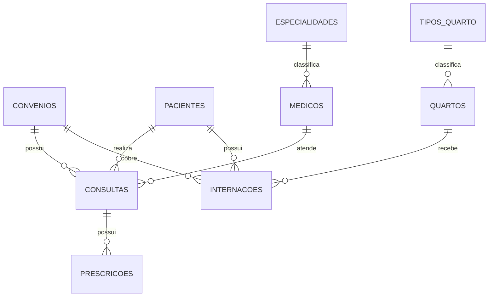

# 🏥 Gestão Hospitalar — Banco de Dados SQL

## 1. Descrição do Projeto

Este projeto consiste no desenvolvimento de um banco de dados para Gestão Hospitalar utilizando o MySQL Workbench.

O sistema organiza informações sobre pacientes, médicos, consultas, convênios, internações, quartos e medicamentos.

## 2. Objetivo

Desenvolver consultas SQL para analisar informações hospitalares, auxiliando nos setores financeiro, administrativo e clínico.

## 3. Banco de Dados

**Nome:** atividade_hospitalar

## 4. Tabelas do Projeto

O banco de dados possui 9 tabelas:

1. Convenios
2. Pacientes
3. Especialidades
4. Medicos
5. Consultas
6. Tipos_quarto
7. Quartos
8. Internacoes
9. Prescricoes

## 5. Consultas SQL Desenvolvidas

1. Faturamento Total de Consultas por Convênio.
2. Média do Valor de Consulta por Especialidade Médica.
3. Valor Médio das Diárias por Tipo de Quarto.
4. Total de Consultas Realizadas por Médico.
5. Soma de Diárias por Paciente com Sobrenome Silva.
6. Contagem de Prescrições por Status da Consulta.
7. Média de Valor de Consultas por Convênio e Especialidade.
8. Média de Diária de Internação por Convênio em Quartos de UTI.
9. Medicamentos Prescritos por Médico em Consultas Realizadas.
10. Valor Total e Média de Consultas por Paciente.

## 6. Comandos SQL Utilizados

- CREATE DATABASE
- CREATE TABLE
- INSERT INTO
- SELECT
- WHERE
- INNER JOIN
- GROUP BY
- SUM()
- AVG()
- COUNT()
- LIKE

## 7. Ferramenta Utilizada

- MySQL Workbench
- GitHub

## 8. Diagrama do Banco de Dados

O banco possui relacionamentos entre pacientes, médicos, consultas, convênios, internações e prescrições.

### Diagrama de Entidade e Relacionamento

## 9. Conclusão

O desenvolvimento deste projeto permitiu praticar a criação de bancos de dados relacionais, construção de tabelas, relacionamentos e consultas SQL.

As consultas possibilitam analisar informações importantes para a organização e administração hospitalar.
