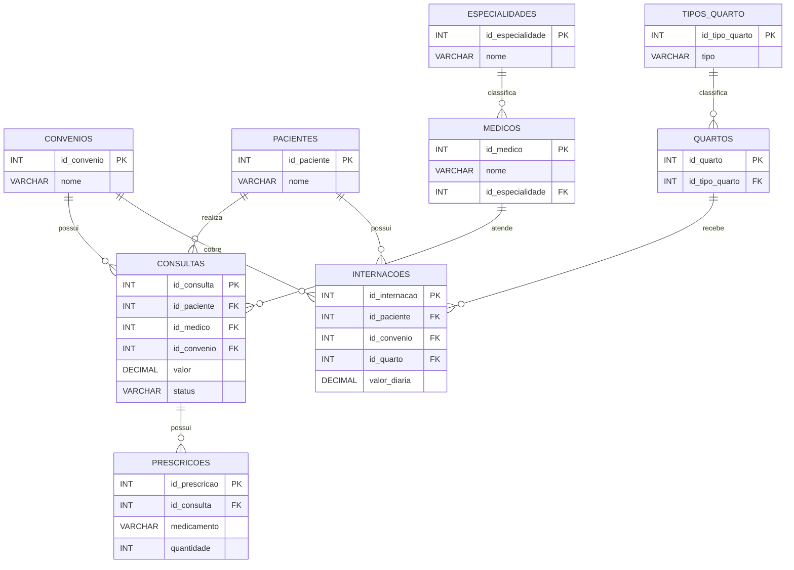

🏥 Gestão Hospitalar — Banco de Dados SQL
---

## 1. DESCRIÇÃO DO PROJETO

Este projeto consiste no desenvolvimento de um banco de dados para Gestão Hospitalar utilizando o MySQL Workbench.

O sistema organiza informações sobre pacientes, médicos, consultas, convênios, internações, quartos e medicamentos.

## 2. OBJETIVO

Desenvolver consultas SQL para analisar informações hospitalares, auxiliando nos setores financeiro, administrativo e clínico.

## 3. BANCO DE DADOS

**Nome:** atividade_hospitalar

**SGBD:** MySQL

**Ferramenta:** MySQL Workbench

## 4. TABELAS DO PROJETO

O banco de dados possui 9 tabelas:

1. **convenios:** armazena os convênios hospitalares.
2. **pacientes:** armazena os dados dos pacientes.
3. **especialidades:** armazena as especialidades médicas.
4. **medicos:** armazena os médicos e suas especialidades.
5. **consultas:** registra as consultas realizadas.
6. **tipos_quarto:** identifica os tipos de acomodações.
7. **quartos:** registra os quartos hospitalares.
8. **internacoes:** registra as internações dos pacientes.
9. **prescricoes:** registra os medicamentos prescritos.

## 5. CONSULTAS SQL DESENVOLVIDAS

1. Faturamento Total de Consultas por Convênio.
2. Média do Valor de Consulta por Especialidade Médica.
3. Valor Médio das Diárias por Tipo de Quarto.
4. Total de Consultas Realizadas por Médico.
5. Soma de Diárias por Paciente com Sobrenome Silva.
6. Contagem de Prescrições por Status da Consulta.
7. Média de Valor de Consultas por Convênio e Especialidade.
8. Média de Diária de Internação por Convênio em Quartos de UTI.
9. Medicamentos Prescritos por Médico em Consultas Realizadas.
10. Valor Total e Média de Consultas por Paciente.

## 6. COMANDOS SQL UTILIZADOS

- CREATE DATABASE
- CREATE TABLE
- INSERT INTO
- SELECT
- WHERE
- INNER JOIN
- GROUP BY
- SUM()
- AVG()
- COUNT()
- LIKE
- ORDER BY

## 7. DIAGRAMA ENTIDADE-RELACIONAMENTO (DER)

O diagrama apresenta as 9 tabelas do banco de dados, seus atributos, chaves primárias (PK), chaves estrangeiras (FK) e relacionamentos.

## 8. RELACIONAMENTOS ENTRE AS TABELAS

- Convênios se relacionam com consultas e internações.
- Pacientes se relacionam com consultas e internações.
- Médicos se relacionam com consultas e especialidades.
- Especialidades se relacionam com médicos.
- Tipos de quarto se relacionam com quartos.
- Quartos se relacionam com internações.
- Consultas se relacionam com prescrições.

## 9. CONCLUSÃO

O desenvolvimento deste projeto permitiu praticar a criação de bancos de dados relacionais, construção de tabelas, relacionamentos e consultas SQL.

As consultas desenvolvidas permitem analisar informações financeiras, clínicas e administrativas, contribuindo para a organização e o gerenciamento hospitalar.

---

**Projeto desenvolvido utilizando MySQL Workbench e GitHub.**
